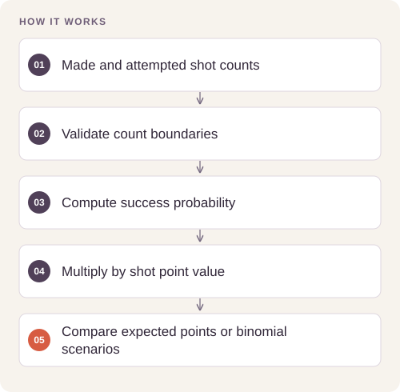

# Basketball Shot Probability Analysis

Estimate shot-making and conditional probabilities, then show precisely which independence assumptions are needed for a binomial projection.

## Implementation

A reusable standard-library probability module with binomial mass, conditional probability, and expected-points comparisons. The original aggregate analysis is included as a machine-readable result record.




## Reproduce and inspect

The executable reproduction profile now records exact commands, input/source hashes, dependency versions, logs and pass/fail status. Its scope distinguishes behavior checks from full-data benchmarks.

[Commands, artifacts and benchmark scope](BENCHMARKS.md) · [Versioned profiles](reproduction.json)


## Try a small example

A small offline fixture exercises the public implementation. It demonstrates the behavior shown below; it does not replace the historical dataset, benchmark or production validation.

After the local setup below, run from the repository root:

```sh
python examples/quickstart.py
```

The [example source](examples/quickstart.py), [captured output](examples/expected-output.txt) and [execution record](examples/environment.json) keep this demonstration inspectable. Floating-point values may vary with library versions.

Observed output from this run:

```text
{
  "three_point_make_probability": 0.41857506361323155,
  "two_point_expected_points": 1.154320987654321,
  "exactly_two_of_four": 0.375
}
```

## Results

The retained study contains 1,434 attempts and 703 makes (49.02%). Two-point shots make 57.72% (374/648), and three-point shots make 41.86% (329/786). Expected points per attempt are therefore about 1.154 and 1.256 respectively, before accounting for context or sampling uncertainty.

The retained aggregates are in [results/aggregate_counts.json](results/aggregate_counts.json). The Python implementation is an improved reusable version of the calculations; historical aggregates and fresh behavior tests have separate scopes.

## Reproduce

Python 3.11 or later; no third-party packages are required.

```sh
python probability.py
python -m unittest discover -s tests -v
```

## Practical relevance and limits

Shots may be dependent and differ in difficulty, player mix, and game context. The expected-points comparison is descriptive and does not prove that choosing a three-pointer improves a team’s outcome.

Raw observations and classroom slide materials are not included. For new analyses, provide your own authorized counts or CSV. No client deployment or commercial result is claimed.
